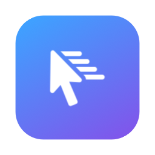

# Jiggle

Легкий jiggler для macOS у рядку меню. Коли ви неактивні довше заданого часу, Jiggle ледь помітно ворушить мишею і не дає Mac заснути, тож статус у месенджерах не перемикається на «Away».

*A tiny macOS menu bar mouse jiggler. Universal build for Intel and Apple Silicon. UI is in Ukrainian.*

<p align="center"></p>

## Можливості

- Рухає мишею лише тоді, коли ви **неактивні** довше вибраного інтервалу (30 с – 10 хв). Поки ви працюєте, не заважає.
- Два режими: **Zen**, непомітний зсув на 1 px і назад, та **Видимий рух**, курсор плавно їде на 30 px і повертається.
- «Не давати Mac заснути»: тримає екран увімкненим через `IOPMAssertion`.
- Запуск під час входу в систему, «Поворушити зараз».
- Налаштування зберігаються між запусками.
- Universal binary: **Intel (x86_64) + Apple Silicon (arm64)**, macOS 13+.

## Встановлення

### Готова збірка

1. Завантажте `Jiggle.zip` з [Releases](../../releases/latest) і розпакуйте.
2. Перенесіть `Jiggle.app` у `/Applications`.
3. Збірка не нотаризована Apple, тому перед першим запуском зніміть карантин:
   ```bash
   xattr -dr com.apple.quarantine /Applications/Jiggle.app
   ```
4. Запустіть і надайте доступ **Accessibility**: System Settings → Privacy & Security → Accessibility.

### Зі сирців

Потрібні лише Xcode Command Line Tools (`xcode-select --install`).

```bash
./build.sh            # зібрати build/Jiggle.app
./build.sh --install  # зібрати, встановити в /Applications і запустити
```

## Accessibility

Рухати курсор програмно можна лише з дозволом Accessibility. Якщо в меню Jiggle видно «⚠︎ Надати доступ Accessibility…», хоча галочка в налаштуваннях стоїть, значить у системі лишився застарілий запис. Скиньте його і надайте доступ знову:

```bash
tccutil reset Accessibility local.jiggle.app
pkill -x Jiggle; open /Applications/Jiggle.app
```

## Структура

| Файл | Що це |
|------|-------|
| `Sources/main.swift` | увесь застосунок (AppKit, menu bar) |
| `build.sh` | збірка universal `.app`, підпис, встановлення |
| `Tools/make_icon.swift` | генератор іконки → `Resources/AppIcon.icns` |

## Ліцензія

[MIT](LICENSE)
